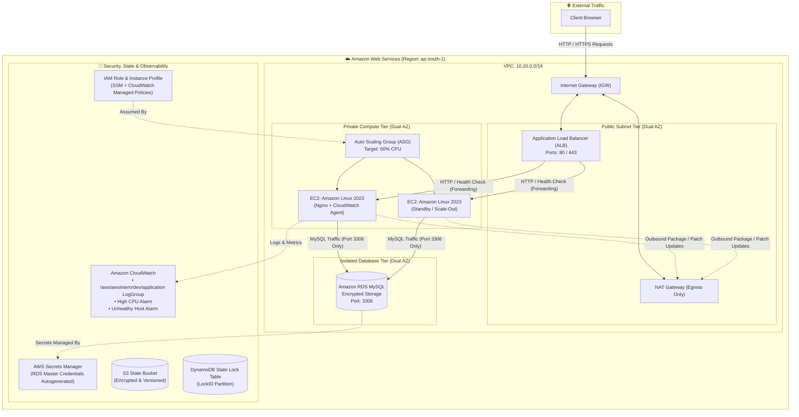

<div align="center">

# ☁️ Enterprise Multi-Tier AWS Infrastructure as Code

### Scalable, Resilient, and Secure Cloud Architecture Provisioned with Modular Terraform

[](https://www.terraform.io/)
[](https://registry.terraform.io/providers/hashicorp/aws/latest)
[](https://aws.amazon.com/)
[](#-architecture-overview)
[](LICENSE)

<p align="center">
  <b>Author:</b> <a href="https://github.com/rahulrayudu12-tech">M. Rahul Rayudu</a> | <b>Domain:</b> Cloud Infrastructure & DevOps | <b>Internship Project</b>
</p>

---

</div>

## 📌 Executive Summary

Manual cloud infrastructure provisioning creates configuration drift, security vulnerabilities, and deployment inconsistencies across environments. This project engineers a complete, production-aligned **Multi-Tier AWS Web Infrastructure** automated through reusable, modular **Terraform (HCL)**.

Designed around the principles of **Defense-in-Depth**, **High Availability**, and **Cost-Aware Elasticity**, this infrastructure isolates compute and database tiers inside private subnets across multiple Availability Zones in `ap-south-1` (Mumbai), terminating public traffic at an Application Load Balancer and routing outbound egress through an isolated NAT Gateway.

---

## 🏛️ Architecture Overview

The system establishes a three-tier network perimeter partitioned into public, private application, and isolated database subnets spanning redundant Availability Zones.



---

## ✨ Key Architectural & Security Decisions

| Dimension | Engineering Implementation | Why It Matters |
|---|---|---|
| **Network Segmentation** | 6 Subnets across 2 AZs (2 Public, 2 Private App, 2 Isolated DB). | Complete isolation preventing direct internet access to compute or data tiers. |
| **Least-Privilege Security Groups** | Security group chaining: ALB accepts 80/443; EC2 only accepts port 80 from ALB SG; RDS only accepts 3306 from EC2 SG. | Eliminates network lateral movement risks; zero open ingress ports to the internet. |
| **Zero Public IP Compute** | Instances launched in private subnets with private IPv4 only. | Immunizes application servers from direct Internet-based port scans and DDoS vectors. |
| **Bastionless Server Management** | AWS Systems Manager (SSM) Session Manager enabled via IAM; IMDSv2 enforced. | Eliminates the attack surface and cost of SSH bastion jumpboxes and static `.pem` keys. |
| **Data Encryption at Rest & In-Transit** | AES-256 EBS volume encryption, encrypted RDS storage, SSL/TLS termination on ALB. | Complies with enterprise compliance standards (SOC2, HIPAA, ISO 27001). |
| **Automated Credential Lifecycle** | RDS master password generated and managed through AWS Secrets Manager. | Zero plaintext credentials or hardcoded passwords in `.tf` or `.tfvars` files. |
| **High Availability & Elasticity** | Multi-AZ ASG with target-tracking scaling policy maintaining average CPU utilization at 60%. | Automatically absorbs traffic spikes and replaces unhealthy compute instances seamlessly. |
| **Cost-Conscious Design** | Single NAT Gateway for dev/demo; `t3.micro` burstable instances; configurable retention. | Minimizes idle spend while maintaining complete architectural fidelity. |
| **State Locking & Consistency** | Isolated S3 bucket with server-side encryption + DynamoDB distributed locking table. | Prevents concurrent pipeline collisions and corruptions during team collaboration. |

---

## 📂 Repository Structure

```text
.
├── main.tf                          # Root composition connecting all infrastructure modules
├── provider.tf                      # AWS provider definition, region, and default tags
├── versions.tf                      # Terraform core and provider version pins
├── variables.tf                     # Input variable definitions with types and validations
├── terraform.tfvars                 # Development environment parameter assignments
├── outputs.tf                       # Exported resource attributes (ALB DNS, VPC ID, etc.)
├── backend.tf.example               # Example template for migrating to remote S3 backend
│
├── modules/                         # Reusable, standalone infrastructure modules
│   ├── vpc/                         # VPC, Public/Private/DB subnets, IGW, NAT, Route Tables
│   ├── security/                    # Tiered Security Groups with chained ingress rules
│   ├── alb/                         # Internet-facing ALB, Target Group, and HTTP/HTTPS Listeners
│   ├── ec2/                         # Launch Template, ASG, IAM Role (SSM/CW), and User Data
│   ├── rds/                         # Private MySQL DB Subnet Group, Instance, and Encryption
│   └── monitoring/                  # CloudWatch Alarms for CPU load and target health
│
├── app/
│   └── index.html                   # Demonstration static web application deployed via user_data
│
├── backend/                         # Standalone bootstrap project for S3 state & DynamoDB lock
│   ├── backend.tf                   # S3 bucket, public access block, DynamoDB table definition
│   ├── variables.tf                 # Bootstrap input parameters
│   ├── versions.tf                  # Version constraints for backend bootstrap
│   └── outputs.tf                   # State bucket name and lock table ARN
│
├── environments/                    # Environment-specific configuration files
│   ├── staging.tfvars               # Staging environment overrides
│   └── prod.tfvars                  # Production environment overrides
│
└── docs/ & deliverables
    ├── DEPLOYMENT.md                # Comprehensive deployment and state migration walkthrough
    ├── TECHSTACK.md                 # Granular technology stack breakdown and tooling versions
    ├── terraform_aws_architecture.md# Full architecture blueprints and traffic flow analysis
    ├── TESTING.md                   # Validation execution logs, test outputs, and plan records
    ├── TROUBLESHOOTING.md           # Remediation playbooks for common Terraform and AWS errors
    └── PROJECT_STATUS.md            # Detailed milestone tracking and verification status
```

---

## 📦 Infrastructure Modules

The architecture is split into six decoupled, single-responsibility modules:

```text
 ┌─────────────────────────────────────────────────────────────┐
 │                         Root Module                         │
 └──────┬────────────┬────────────┬─────────────┬────────────┬─┘
        │            │            │             │            │
 ┌──────▼──────┐ ┌───▼────┐ ┌─────▼───────┐ ┌───▼────┐ ┌─────▼───────┐
 │ modules/vpc │ │security│ │ modules/alb │ │modules/│ │ modules/rds │
 └─────────────┘ └────────┘ └─────────────┘ │  ec2   │ └─────────────┘
                                            └────────┘
                                                 │
                                            ┌────▼─────────────┐
                                            │modules/monitoring│
                                            └──────────────────┘
```

1. **`vpc`**: Provisons the foundational network, assigning CIDRs (`10.20.0.0/16`), creating 6 subnets across 2 AZs, attaching an Internet Gateway, and establishing NAT egress routes.
2. **`security`**: Constructs distinct security groups for ALB, Application EC2, and RDS with zero circular references using security group ID source chaining.
3. **`alb`**: Provisions an external HTTP Application Load Balancer with health checks (`/`), target group bindings, and optional TLS/Route 53 alias support.
4. **`ec2`**: Generates IAM instance profiles (AmazonSSMManagedInstanceCore, CloudWatchAgentServerPolicy), an IMDSv2-enforced Launch Template with cloud-init bootstrap, and an Auto Scaling Group with Target Tracking.
5. **`rds`**: Launches a private MySQL instance (`db.t3.micro`) inside an isolated DB subnet group with storage encryption enabled and managed credentials via Secrets Manager.
6. **`monitoring`**: Configures CloudWatch metric alarms for ASG Average CPU Utilization (`> 60%`) and ALB Unhealthy Host Count (`>= 1`).

---

## 🚀 Quick Start & Deployment Guide

### 1. Prerequisites
- [Terraform CLI](https://www.terraform.io/downloads) `v1.5.0+` (tested with `v1.17.2`)
- [AWS CLI v2](https://aws.amazon.com/cli/) installed and configured
- An active AWS Account with an authenticated profile (e.g. AWS IAM Identity Center / SSO profile named `dev`):

```bash
aws sso login --profile dev
aws sts get-caller-identity --profile dev
```

### 2. Clone the Repository
```bash
git clone https://github.com/rahulrayudu12-tech/terraform-aws-multi-tier-infrastructure.git
cd terraform-aws-multi-tier-infrastructure
```

### 3. Local Verification & Static Analysis
Run formatting checks and syntax validation before provisioning:

```bash
# Format HCL code recursively
terraform fmt -check -recursive

# Initialize working directory and download providers
terraform init -input=false

# Validate configuration syntax and resource arguments
terraform validate
```

### 4. Speculative Execution Plan
Inspect proposed resource changes without modifying real-world infrastructure:

```bash
terraform plan -input=false -var-file="terraform.tfvars"
```
> **Plan Result:** 38 additions, 0 to change, 0 to destroy.

### 5. Provision Infrastructure *(When ready to apply)*
```bash
terraform apply -input=false -var-file="terraform.tfvars"
```

Once provisioning completes, Terraform outputs the public ALB DNS name:
```bash
Apply complete! Resources: 38 added, 0 changed, 0 destroyed.

Outputs:
alb_dns_name = "awsintern-dev-alb-123456789.ap-south-1.elb.amazonaws.com"
vpc_id       = "vpc-0a1b2c3d4e5f6g7h8"
```

Open `http://<alb_dns_name>` in your browser to verify that the load-balanced static application is responding.

### 6. Clean Teardown
To avoid unwanted AWS charges when testing is finished:
```bash
terraform destroy -input=false -var-file="terraform.tfvars"
```

---

## 🔒 Remote State Management (Optional Bootstrap)

For team environments requiring concurrent execution locks:

1. Navigate to the `backend/` directory:
   ```bash
   cd backend
   terraform init
   terraform apply
   ```
2. Copy the generated S3 bucket and DynamoDB table names into `backend.tf`:
   ```bash
   cp ../backend.tf.example ../backend.tf
   ```
3. Re-initialize the root module to migrate local state to AWS:
   ```bash
   cd ..
   terraform init -migrate-state
   ```

---

## 📊 Environment Parameter Matrix

| Parameter | Dev Default | Staging | Prod | Description |
|---|---|---|---|---|
| `aws_region` | `ap-south-1` | `ap-south-1` | `ap-south-1` | Target AWS deployment region |
| `instance_type` | `t3.micro` | `t3.small` | `t3.medium` | EC2 compute instance size |
| `asg_min_size` | `1` | `2` | `2` | Minimum instances in Auto Scaling |
| `asg_desired_capacity` | `1` | `2` | `4` | Target active compute instances |
| `asg_max_size` | `2` | `4` | `8` | Maximum scale-out ceiling |
| `db_instance_class` | `db.t3.micro` | `db.t3.small` | `db.t3.medium` | RDS MySQL compute sizing |
| `enable_nat_gateway` | `true` | `true` | `true` | Enables outbound private egress |
| `enable_https` | `false` | `true` | `true` | Requires ACM cert & Route 53 zone |

---

## 📑 Project Documentation Index

- 📘 [DEPLOYMENT.md](DEPLOYMENT.md) — Step-by-step AWS provisioning and remote state migration instructions.
- 🏗️ [terraform_aws_architecture.md](terraform_aws_architecture.md) — Exhaustive network diagrams, data paths, and security boundaries.
- 🧪 [TESTING.md](TESTING.md) — Full execution logs for `terraform fmt`, `init`, `validate`, and `plan`.
- 🛠️ [TECHSTACK.md](TECHSTACK.md) — Breakdown of tools, providers, versions, and AWS service tiers.
- 🩺 [TROUBLESHOOTING.md](TROUBLESHOOTING.md) — Solutions for common AWS credentials, provider lock, and VPC quota issues.
- 📈 [PROJECT_STATUS.md](PROJECT_STATUS.md) — Project milestones, audit log, and verification status.

---

## 👨‍💻 Author & Acknowledgments

- **Engineer:** M. Rahul Rayudu
- **Role:** AWS Cloud & DevOps Engineering Intern
- **GitHub:** [@rahulrayudu12-tech](https://github.com/rahulrayudu12-tech)

*Developed as part of the Terraform AWS Infrastructure Deployment Internship Program.*
