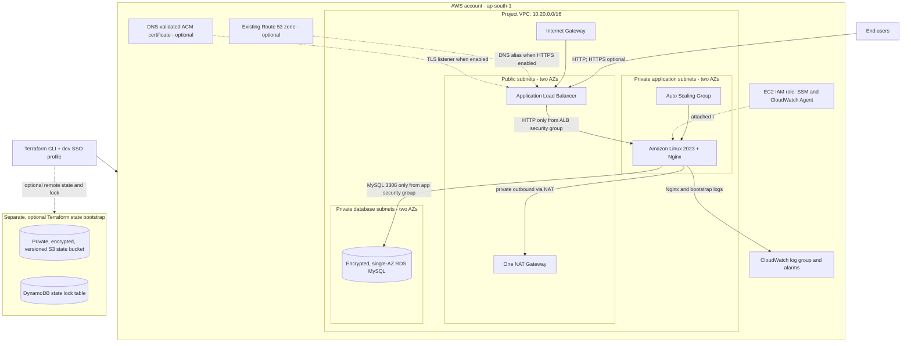

# Terraform-Based Infrastructure Deployment on AWS

## Project objective

Automate a repeatable, tagged, segmented AWS web-infrastructure deployment
using Terraform. This architecture is a deadline-focused demonstration of the
abstract, not a claim of production readiness.

## Implemented system architecture

The backend bucket and lock table are created by a separate Terraform
configuration under `backend/`. They are not part of the application
infrastructure plan and are not created unless the user separately reviews
and applies the bootstrap configuration.

## AWS component responsibilities

| Component | Responsibility and implementation |
|---|---|
| VPC | Isolated IPv4 network (`10.20.0.0/16`) with DNS support enabled. |
| Public subnets | Two AZ subnets for internet-facing ALB and NAT Gateway. Public route table sends default traffic to the Internet Gateway. |
| Application subnets | Two private subnets for EC2; no public IPs. Private route table uses a single NAT Gateway for outbound access. |
| Database subnets | Two private, isolated subnets with no internet default route, used by the RDS subnet group. |
| ALB | Public HTTP entry point, forwards to an instance target group; HTTPS is optional and requires an existing domain/hosted zone. |
| EC2/ASG | Amazon Linux 2023 instances run the sample HTML page via Nginx. Auto Scaling maintains configured capacity and tracks average CPU at 60%. |
| RDS MySQL | Private, encrypted, single-AZ DB for architectural demonstration. RDS manages the master password in Secrets Manager. The static app does not connect to it. |
| IAM | Per-instance role provides the AWS-managed SSM and CloudWatch Agent policies; instances use IMDSv2. |
| CloudWatch | Collects Nginx/bootstrap logs and has alarms for high ASG CPU and unhealthy ALB targets. |
| S3/DynamoDB | Optional, isolated backend bootstrap for encrypted/versioned Terraform state storage and state locking. |
| Route 53/ACM | Optional DNS and TLS resources, only when a valid existing hosted zone and domain are supplied. |

## Network and security boundaries

- ALB security group accepts public port 80. Port 443 opens only when optional
  HTTPS is enabled.
- EC2 has no public IP. Its security group accepts port 80 only from the ALB
  security group.
- RDS is not publicly accessible; port 3306 is allowed only from the EC2
  application security group.
- Database subnets have no direct internet route. Application private subnets
  route egress through one NAT Gateway. The single NAT reduces duplicate NAT
  charges relative to a per-AZ design, but is not AZ-resilient.
- AWS credentials are sourced from IAM Identity Center profile `dev`. No
  credentials are embedded in Terraform.
- RDS storage and EC2 root volumes are encrypted. The optional state bucket
  enables encryption, versioning, and public-access blocking.

## Application and data flow

The sample `app/index.html` is embedded into EC2 launch-template user data.
On launch, EC2 installs Nginx and the CloudWatch Agent, writes the page to
Nginx's document root, and configures Nginx and cloud-init log collection.
Client requests reach the public ALB, which selects a healthy EC2 target.

The RDS resource demonstrates a private managed database layer. The static
sample web page does not query it and no database schema or application
credentials are delivered to EC2. To connect a real application, a later
change must retrieve the RDS-managed secret securely and implement database
access.

## Terraform layout and dependencies

- Root files configure the provider, inputs, outputs, and module wiring.
- `modules/vpc` creates the VPC, three subnet tiers, IGW, NAT, routes, and
  associations.
- `modules/security` creates the ALB, application, and DB security groups.
- `modules/alb` creates the ALB, target group, listener, and optional DNS/TLS.
- `modules/ec2` creates the instance role/profile, launch template, ASG, and
  CPU target-tracking policy.
- `modules/rds` creates the private DB subnet group and MySQL instance.
- `modules/monitoring` creates metric alarms; the root creates the log group.
- `backend/` is a separate Terraform root for optional state backend resources.

## Deployment workflow

1. Authenticate with `aws sso login --profile dev`.
2. Format, initialize, and validate the application root.
3. Generate and review `terraform plan`; inspect resource actions and cost
   implications.
4. Optionally bootstrap the S3 bucket and DynamoDB table in `backend/` after a
   separate plan review and explicit decision to create them.
5. Optionally migrate local state to S3 using the provided backend example,
   unique state key, and bootstrap outputs.
6. Only after explicit user approval, apply the reviewed application plan.
7. Verify Terraform outputs, the ALB application URL, target health, and
   CloudWatch logs/alarms.
8. Review a destroy plan and snapshots before any separately approved cleanup.

`terraform init`, `validate`, and `plan` do not create the declared
infrastructure. No apply, destroy, deployed URL, or AWS resource verification
is claimed as part of this document.

## Cost and limitations

NAT Gateways, ALBs, EC2, RDS, public IPv4 addresses, CloudWatch resources, and
RDS-managed secrets may incur charges. Free-tier eligibility depends on the
account, region, service, and current AWS terms. Review current pricing and
the plan before deployment.

The default is a single NAT, one desired EC2 instance (scalable up to two),
single-AZ RDS, HTTP-only access, and short retention. These are learning/demo
defaults; they do not meet production HA, disaster recovery, or complete
application security requirements. Route 53 and ACM are disabled unless the
user supplies an existing domain and hosted zone.
